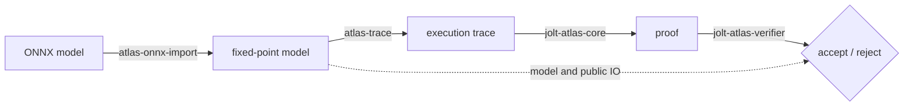

# Jolt Atlas

**Fast, exact proofs of neural-network inference.**

[](https://github.com/ICME-Lab/jolt-atlas/actions/workflows/rust.yml)


Jolt Atlas proves that an ONNX model was run correctly on a given input. Give it a model and an
input, and it returns the output with a proof; anyone holding the model can check that proof in a
fraction of the time it took to make. It proves transformer models such as Qwen2-0.5B, GPT-2 and
BGE in seconds on a CPU.

Built by [ICME Labs](https://blog.icme.io/) on the ideas of [Jolt](https://github.com/a16z/jolt):
sumcheck everywhere, lookups instead of circuits for nonlinear functions, and commitments to
small values only.


> [!WARNING]
> Jolt Atlas is a research prototype. It has not been audited, its proof format changes without
> notice, and proofs are **not zero-knowledge** yet: the model, its input and its output are all
> public to the verifier. Do not rely on it to protect anything of value.

## Performance

Prove and verify on one machine, 16 tokens, the whole proof (trace execution, commitment,
sumchecks and the opening proof):

| Model | Parameters | Prove | Verify | Proof size | Peak memory |
| ----- | ---------: | ----: | -----: | ---------: | ----------: |
| [Qwen2-0.5B](https://huggingface.co/Qwen/Qwen2-0.5B) | 494 M | 2.71 s | 230 ms | 1.77 MiB | 8.2 GB |
| [GPT-2](https://huggingface.co/openai-community/gpt2) | 124 M | 1.16 s | 106 ms | 1.33 MiB | 2.8 GB |
| [BGE-small-en-v1.5](https://huggingface.co/BAAI/bge-small-en-v1.5) | 33 M | 0.83 s | 90 ms | 1.28 MiB | 1.0 GB |

AWS c7g.8xlarge (32 Graviton3 cores, 64 GB), median of three runs, commit `d8fe08fde`
(2026-11-19). The proof system targets 128 bits of security. To reproduce, see
[Benchmarking](#benchmarking).

## Quickstart

You need a Rust toolchain ([rustup](https://rustup.rs) installs the pinned 1.95 from
`rust-toolchain.toml`). Three small models are checked in, so the first proof needs no download:

```bash
git clone https://github.com/ICME-Lab/jolt-atlas && cd jolt-atlas
cargo run --release -p jolt-atlas-core --example prove -- --model models/qwen2-tiny
```

It imports the model, runs it, proves the run, verifies the proof and prints the timings and
the proof size, ending with `Proof verified successfully!`.

### Real models

The full-size models come from Hugging Face and are exported to ONNX with a pinned toolchain
(Python 3.11):

```bash
python3 -m venv .venv && source .venv/bin/activate
python scripts/download_gpt2.py                 # → models/gpt2
python scripts/download_bge_small_en_v1_5.py    # → models/bge-small-en-v1.5
python scripts/download_qwen.py                 # → models/qwen (2.5 GB)

cargo run --release -p jolt-atlas-core --example prove -- --model models/gpt2
cargo run --release -p jolt-atlas-core --example prove -- --model models/qwen \
    --input "The quick brown fox jumps over the lazy dog"
```

`prove` options:

| Option | Effect |
| ------ | ------ |
| `--seq-len N` | sequence length (default 16) |
| `--input "<text>"` | tokenize with the model's `tokenizer.json`; the length is the token count |
| `--use-cache` | reuse the model's preprocessing across runs |
| `--trace-terminal` | per-stage timings on the terminal |
| `--trace` | a Chrome trace (open in `chrome://tracing` or [Perfetto](https://ui.perfetto.dev)) |
| `--stats` | the model, its range checks and its largest nodes |
| `--schedule` | print the verification schedule and exit |

## How it works



1. **Import.** A tract-free ONNX frontend decodes the graph, infers static shapes, folds
   constants, quantizes the weights and lowers every node to a small closed set of integer ops.
2. **Execute.** The model runs in exact fixed-point arithmetic. Every value is an integer at a
   power-of-two scale; a chain of products is computed exactly and rounded once at its end;
   an overflow is an error, never a clamped value. Nonlinear functions are lookup tables
   generated by integer arithmetic, so the prover and the trace agree bit for bit. There is no
   floating point anywhere.
3. **Prove.** Every op is a sumcheck relation. Matrix products are sumchecks over the weights;
   activations, softmax and range checks are reads of structured lookup tables. Relations that
   are ready at the same time are batched into one sumcheck. The committed polynomials, all of
   small values, are bit-packed into a single [BitZ](specs/bitz-commitment.md) commitment over
   `F_{2^128}`, opened once at the end with a GKR grand product, ring switching and a
   Ligerito proof. Hash-based, no trusted setup, no
   elliptic curves.
4. **Verify.** The verifier compiles the same schedule from the model alone and reads the
   proof once, front to back. It never trusts the prover for anything the trace semantics
   define.

### Supported ops

The importer lowers ONNX graphs to 34 ops: arithmetic (`Add`, `Sub`, `Mul`, `Neg`, `Square`,
`Cube`, division by a constant), contractions (`Einsum`, which covers `MatMul` and `Gemm`, and
`Sum`), normalization (`MeanOfSquares`, `Rsqrt`), activations (`ReLU`, `Tanh`, `Sigmoid`, `Erf`,
GELU and SiLU as one fused op), `Sin` and `Cos`, softmax over the last axis, gathers, `Where`,
and the shape ops (`Reshape`, `Slice`, `Concat`, `Broadcast`, transposes). Convolutions, pooling,
`Exp` and `Log` are not supported yet; [docs/op-roadmap.md](docs/op-roadmap.md) ranks what comes
next.

## Repository layout

| Crate | Role |
| ----- | ---- |
| [`atlas-onnx-import`](atlas-onnx-import) | ONNX decoding, shape inference, constant folding, quantization, lowering |
| [`atlas-trace`](atlas-trace) | the fixed-point IR, op semantics and lookup-table generation, the executor |
| [`jolt-atlas-core`](jolt-atlas-core) | the prover, its test suite and the `prove` example |
| [`jolt-atlas-verifier`](jolt-atlas-verifier) | the proof format and all verification; no prover code |
| [`atlas-sumcheck`](atlas-sumcheck) | the batched sumcheck engine, relations, opening reduction, lookup arguments |
| [`atlas-pcs`](atlas-pcs) | the BitZ polynomial commitment scheme |
| [`atlas-claims`](atlas-claims) | symbolic sumcheck relations: the verifier is derived from them |
| [`atlas-algebra`](atlas-algebra) | the 128-bit Solinas field, multilinear polynomials |
| [`atlas-transcript`](atlas-transcript) | the Fiat–Shamir transcript; the proof is its byte string |
| [`atlas-lookup-tables`](atlas-lookup-tables) | prefix-suffix decomposable lookup tables |
| [`common`](common) | shared constants, serialization and allocator helpers |

`models/` holds the model zoo: the checked-in fixtures (`op_gauntlet`, which covers every
lowerable op, and random-weight `gpt2-tiny`, `qwen2-tiny` and `bge-tiny` with the production
architectures) and, once downloaded, the real models.

## Testing

```bash
cargo nextest run --workspace     # what CI runs on every push (about a minute once built)
```

The suite lives in [`jolt-atlas-core/src/onnx_proof/testing/`](jolt-atlas-core/src/onnx_proof/testing):

- **Op surface:** one proving case for each op variant. A new variant does not compile until it
  has one.
- **Soundness sweeps:** every value the verifier reads is mutated, the execution trace is
  tampered before proving, and every opening claim is forged; each must be rejected. Set
  `JOLT_SOUNDNESS_EXHAUSTIVE=1` to try every site (CI does nightly).
- **Model zoo:** the checked-in models end to end on every run; the real models in the heavy
  job (`--profile heavy --run-ignored ignored-only`).
- **Known gaps:** open issues are pinned as `#[ignore]`d `known_gap_*` tests that fail today
  and pass once fixed.

## Benchmarking

```bash
cargo run --release -p jolt-atlas-core --example prove -- --model models/qwen --trace-terminal
```

On Linux, `prove` asks the kernel for transparent huge pages on large buffers, worth about 15%
of prove time; it has no effect on macOS. `bench/gate.sh` compares commits: it builds `prove` at
each one, interleaves the runs and reports per-stage medians. Compare timings only between runs
on the same machine.

## Documentation

- [docs/verifier.md](docs/verifier.md): the trust perimeter and the order to audit it in
- [docs/prover-plan.md](docs/prover-plan.md): where prover time goes and what is planned
- [docs/op-roadmap.md](docs/op-roadmap.md): op coverage and what to add next
- [specs/](specs): the design of every large change, frozen when it merged
- [CONTRIBUTING.md](CONTRIBUTING.md) and [docs/pull-requests.md](docs/pull-requests.md): how to
  contribute

## License

Jolt Atlas is **not open source**. It is licensed by ICME for internal testing and evaluation;
see [LICENSE](LICENSE) for the terms.

## Acknowledgments

Jolt Atlas builds on [Jolt](https://github.com/a16z/jolt) by a16z crypto, whose sumcheck,
lookup and transcript designs it adapts; [docs/upstream-inventory.md](docs/upstream-inventory.md)
records what came from where. Thanks to the Jolt team for their foundational work.
